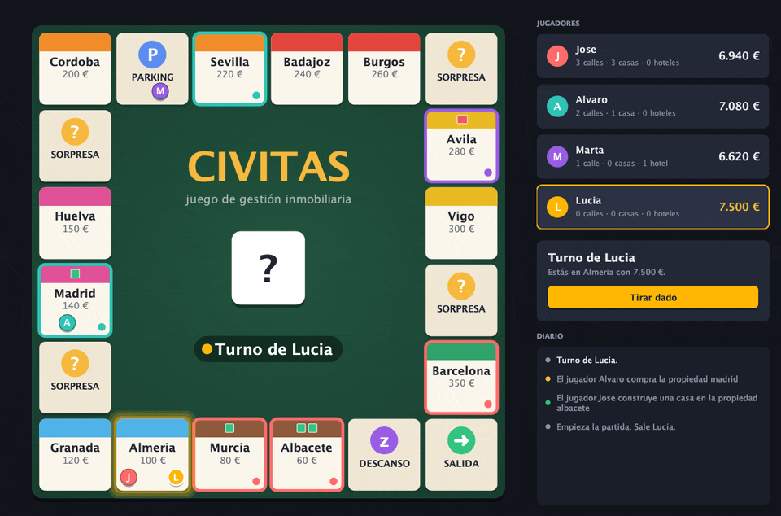

# Civitas

A property-trading board game for 2–4 players, written in Java with an MVC architecture, an animated Swing board and an alternative text-mode interface.




## Features

- **Local multiplayer for 2–4 players** taking turns on the same computer, each with a coloured token.
- **Property management:** buy streets, build houses and hotels, and collect rent from other players. Every player starts with 7,500 € and earns 1,000 € each time they pass *Start*.
- **Shuffled deck of surprise cards** that add or take money, either a flat amount or per house/hotel owned.
- **Animated board** drawn with Java2D: rolling dice, tokens that hop square by square, owner colours, and buildings shown on each street.
- **Two interchangeable views** (graphical and text) driven by the same controller and game model.
- **Final ranking** shown on the board as soon as a player goes bankrupt.

## Tech stack

| Technology | Used for |
|---|---|
| **Java 18+** (tested with OpenJDK 21) | Game model, controller and views. No external dependencies. |
| **Swing + Java2D** | Graphical interface. The board, cards and buttons are custom-painted. |
| **Apache Ant / NetBeans project** | The original build setup (`build.xml`, `nbproject/`). Optional. |
| **Bash** (`run.sh`, `test.sh`) | Compiles and launches the game, or runs the tests, in one command with plain `javac`/`java`. |
| **Dependency-free test runner** | 14 tests covering the model rules: buying, rent, building, passing *Start*, surprises and bankruptcy. |

## Getting started

**Requirements:** a JDK, version 18 or newer. On macOS:

```bash
brew install openjdk@21
```

**Run the graphical version** (compiles into `build/classes` and launches):

```bash
git clone https://github.com/josedimas23/civitas-board-game.git
cd civitas-board-game
./run.sh
```

`run.sh` uses `JAVA_HOME` if it is set, then Homebrew's `openjdk@21`, then whatever `javac` is on your `PATH`.

**Or compile and run by hand:**

```bash
mkdir -p build/classes
javac -encoding UTF-8 -d build/classes $(find src -name '*.java')
java -cp build/classes GUI.Main
```

**Text mode** (play in the terminal; player names are optional arguments):

```bash
java -cp build/classes JuegoTexto Ana Luis
```

**Tests:**

```bash
./test.sh
```

**NetBeans:** open the folder as a project and press *Run*. The main class is `GUI.Main`.

## Project structure

```
src/
├── civitas/              # Model: game rules and state
│   ├── CivitasJuego.java     # Game facade: players, board, turns
│   ├── GestorEstados.java    # Turn state machine
│   ├── Tablero.java          # Board and movement
│   ├── Casilla*.java         # Squares: base, street, surprise
│   ├── Sorpresa*.java        # Surprise cards (abstract + variants)
│   ├── Jugador*.java         # Players (incl. "speculator" subclass)
│   └── Diario.java           # Event log read by the views
├── controladorCivitas/   # Controller: game loop, depends only on the Vista interface
└── GUI/                  # Views
    ├── Vista.java            # View interface
    ├── CivitasView.java      # Main Swing window
    ├── TableroPanel.java     # Animated board (Java2D)
    ├── JugadoresPanel.java   # Player cards
    ├── CapturaNombres.java   # Start screen
    ├── VistaTextual.java     # Text-mode view
    └── Main.java             # GUI entry point
src/JuegoTexto.java       # Text-mode entry point
test/civitas/ModeloTest.java  # Model tests
run.sh · test.sh          # One-command build & run / tests
docs/                     # README media
```

## What I learned

- **Designing around an interface.** The controller originally depended on the concrete Swing window. Changing it to use the `Vista` interface was enough to bring the text view back, and it showed me in practice why MVC separates the two.
- **Inheritance and polymorphism in a real domain:** squares, surprise cards and players are class hierarchies, and the game relies on dynamic dispatch (`recibeJugador`, `aplicarAJugador`).
- **Polymorphism bugs are silent.** Surprise squares never did anything because their handler was a private method with a different name, so it never overrode the base one. Nothing failed to compile. Now I use `@Override` everywhere, and a regression test covers it.
- **Swing threading:** the game loop runs on its own thread and blocks until the player clicks, while every animation and repaint stays on the Event Dispatch Thread.

## Context & credits

This was a pair project for the **Programación y Diseño Orientado a Objetos** (Object-Oriented Programming and Design) course at the **University of Granada** (2022), written by **Jose Dimas Sánchez Casas** and **Álvaro R.** We implemented the game model, the controller and the original Swing and text views together.

In 2026 I revisited the project for my portfolio, working with an AI-assisted workflow (Claude Code). It involved these changes:
- I replaced the original NetBeans-form GUI with the animated, custom-painted board.
- I fixed the surprise squares, the unshuffled deck and a duplicated *Start* square.
- I added model tests.
- I removed dead code and added the one-command launcher.

The project specification and some scaffolding belong to the course teaching staff: the game rules, the turn state machine in `GestorEstados` and the state/operation enums. I have kept them here only as part of a finished, already-graded assignment. Our own code is released under the [MIT License](LICENSE).
